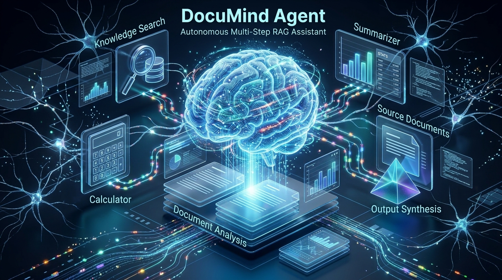

# DocuMind-Agent-Autonomous-Multi-Step-RAG-Assistant
🧠 DocuMind Agent: An autonomous Multi-Step Agentic RAG system built with LangGraph, Groq (Llama 3.3), ChromaDB, and Gradio. Features dynamic query refinement, multi-document comparison, specialized analytical tools, and live reasoning transparency.

<div align="center">
  

  # 🧠 DocuMind Agent: Autonomous Multi-Step RAG Assistant
  
  **Intelligent Query Planning • Dynamic Tool Routing • Multi-Document Comparison • Verified Citations**

  [](https://python.org)
  [](https://github.io)
  [](https://groq.com)
  [](https://gradio.app)
</div>

---

## 📖 Overview

**DocuMind Agent** is an advanced **Agentic Retrieval-Augmented Generation (Agentic RAG)** system designed to understand complex, multi-step user queries, autonomously plan retrieval strategies, dynamically invoke specialized tools, and synthesize accurate, source-cited answers from multiple documents.

Unlike traditional RAG pipelines that follow a rigid *"retrieve-then-generate"* sequence, DocuMind embeds a **ReAct (Reasoning + Acting) AI Agent** capable of query refinement, cross-document comparison, statistical computation, and real-time execution transparency.

---

## 🌟 Key Features

- **End-to-End Ingestion Pipeline:** Automated PDF text extraction, noise cleaning, semantic overlapping chunking, HuggingFace embedding generation (`all-MiniLM-L6-v2`), and local vector indexing via **ChromaDB**.
- **Multi-Step Agentic Reasoning:** Powered by **LangGraph** and **Groq (`llama-3.3-70b-versatile`)** to decompose complex queries into logical sub-tasks.
- **Autonomous Tool Routing:** Dynamically selects from 4 specialized tools based on query intent:
  1. 🔍 **`search_knowledge_base`**: Semantic vector search returning top relevant chunks with exact file names and page citations.
  2. 🧮 **`calculator_tool`**: Safe mathematical expression evaluator for exact arithmetic and percentage differences.
  3. 📊 **`data_analysis_tool`**: Statistical analyzer computing sum, mean, min, max, and percentage growth rates.
  4. 📝 **`summarizer_tool`**: Condenses lengthy multi-document passages into structured key metrics before comparison.
- **Self-Correcting Query Refinement:** Automatically rephrases search queries when initial retrieval results are incomplete.
- **Interactive Gradio Workspace:** Two-tab web interface featuring a document indexing dashboard, conversational chat, and a live **Agent Reasoning & Tool Execution Trace** panel.

---

## 🏗️ System Architecture & Workflow

```text
[User Query] 
     │
     ▼
┌─────────────────────────────────────────────────────────┐
│             LangGraph ReAct Agent (Llama 3.3)           │
│  1. Plan & Decompose Query                              │
│  2. Select & Execute Optimal Tool(s)                    │
│  3. Evaluate Evidence & Refine Query (Loop if needed)   │
└────┬──────────────┬──────────────┬──────────────┬───────┘
     │              │              │              │
     ▼              ▼              ▼              ▼
[KB Search]   [Calculator]   [Data Analysis]  [Summarizer]
     │
     ▼
[Chroma Vector DB] ◄── [Ingestion Pipeline: Extract → Clean → Chunk → Embed]
```

---

## ⚖️ Standard RAG vs. DocuMind (Agentic RAG)

| Feature | Standard RAG | DocuMind (Agentic RAG) |
| :--- | :--- | :--- |
| **Execution Flow** | Static, single-pass (`Retrieve → Generate`) | Dynamic, iterative reasoning loop (`Plan → Act → Observe`) |
| **Query Handling** | Uses raw user prompt as-is | Decomposes complex questions & refines weak queries |
| **Calculations & Stats** | Prone to LLM math hallucinations | Delegates math & growth rates to dedicated Python tools |
| **Multi-Doc Comparison** | Struggles to synthesize across files | Retrieves per entity, summarizes, and compares systematically |
| **Transparency** | Black-box text output | Live step-by-step trace of agent reasoning & tool calls |

---

## 🚀 Quick Start & Installation

### 1. Clone the Repository
```bash
git clone https://github.com
cd DocuMind-Agentic-RAG
```

### 2. Install Dependencies
```bash
pip install -r requirements.txt
```

### 3. Configure Environment Variables
Set your free **Groq API Key** as an environment variable:
```bash
export GROQ_API_KEY="your_groq_api_key_here"
```
*(Or set `os.environ["GROQ_API_KEY"]` directly inside the Google Colab notebook).*

### 4. Run the Application
Run the notebook cells in **Google Colab** or launch locally:
```bash
python app.py
```

---

## 💡 Example Multi-Step Test Prompts

Once you upload your PDF documents in **Tab 1 (`Knowledge Base Setup`)** and build the index, try these prompts in **Tab 2 (`Agentic Workspace`)**:

- *"Summarize the main objectives and key findings across all uploaded documents with exact page citations."*
- *"Compare the revenue figures between 2023 and 2024 mentioned in the reports, calculate the exact percentage growth rate, and explain the main drivers."*
- *"Extract all numerical metrics mentioned in the documents and compute their average and maximum values."*

---

## 🛠️ Tech Stack

- **Agent Orchestration:** LangChain & LangGraph
- **LLM Inference:** Groq API (`llama-3.3-70b-versatile`)
- **Embeddings:** HuggingFace (`sentence-transformers/all-MiniLM-L6-v2`)
- **Vector Database:** ChromaDB
- **Document Parsing:** PyPDF
- **User Interface:** Gradio

---

## 📄 License
This project is open-source and available under the [MIT License](LICENSE).
